# Awesome-Cloud-Data-Warehouse-Architecture 🚀

  

  
  
  
  
  
  

> 📚 A curated list of modern **Cloud Data Warehouse (CDW)** architectures, analytical databases, Massively Parallel Processing (MPP) engines, and open Lakehouse query infrastructures.

**Top Cloud Data Warehouse Architecture (Open-Source & Managed) 🌟 Star if you like it! 🌟**

*Focused on Separation of Storage and Compute, MPP Engines, Lakehouse Integration, Vectorized Execution & Self-Hosted Analytical Databases.* ⚡

**Last updated: October 2026** 📅

---

## 📖 Table of Contents

- [🌐 Sector Overview & Market Dynamics](#-sector-overview--market-dynamics)
- [🏢 SaaS & Hosted CDW Platforms](#-saas--hosted-cdw-platforms)
- [🔓 Open-Source GitHub Projects](#-open-source-github-projects)
- [⚖️ Key Architectural Trade-offs](#️-key-architectural-trade-offs)
- [🤝 How to Contribute](#-how-to-contribute)
- [💖 Support](#-support)
- [📊 Star History](#-star-history)
- [📜 License & Disclaimer](#-license--disclaimer)

---

## 🌐 Sector Overview & Market Dynamics

The global Cloud Data Warehouse (CDW) and modern lakehouse analytical market is estimated at **$14.9 billion to $16.5 billion in 2026**, expanding rapidly at a Compound Annual Growth Rate (CAGR) of **~21%–25%** driven by generative AI workloads, real-time analytics, and enterprise data migration away from legacy on-premises appliances. 📈

The sector is **moderately fragmented**: while hyperscale cloud providers (AWS, Microsoft Azure, Google Cloud) and independent industry titans (Snowflake, Databricks) command substantial market revenue, the landscape is heavily fractured rather than a "winner-take-all" domain. The rapid adoption of open table formats (Apache Iceberg, Delta Lake), federated query abstractions (Trino, Starburst), embedded in-process analytics (DuckDB), and high-throughput real-time OLAP engines (ClickHouse, StarRocks, Apache Doris) empowers specialized platforms to capture significant niches across hybrid-cloud, edge, and operational analytical workloads. 🧩

---

## 🏢 SaaS & Hosted CDW Platforms

The following table compares leading SaaS and fully managed cloud data warehouse platforms. Entries are sorted in descending order by **Company Size (Revenue / Market Capitalization / Valuation)**. 📊

| 🏢 Platform | 💰 Company Size (Market Cap / Valuation / ARR) | 🏗️ Architecture & Capabilities | 💵 Pricing (Starting Tier) | 🎁 Free Tier / Trial Limits | 🎯 Best For |
| :--- | :--- | :--- | :--- | :--- | :--- |
| **[Google BigQuery](https://cloud.google.com/bigquery)** | **~$2.1T+** (Alphabet Market Cap) | Fully serverless, columnar storage with Capacitor engine; execution over petabit Jupiter network; separation of compute and storage. | **$6.25 / TB** scanned (On-Demand) or editions starting from **$0.04 / slot-hour** (Standard Edition); storage from **$0.02 / GB/mo** | **Always Free Tier:** 1 TB queries/month scanned and 10 GB storage free every month forever. New users also receive a $300 90-day credit trial. | Spiky or unpredictable workloads needing zero operational overhead and instant serverless scaling. |
| **[Azure Synapse Analytics](https://azure.microsoft.com/en-us/products/synapse-analytics)** | **~$3.0T+** (Microsoft Market Cap) | Unified analytics workspace combining Dedicated SQL pools (MPP), Serverless SQL pools (lake querying), and Spark pools over ADLS Gen2. | **$5.00 / TB** processed (Serverless SQL); Dedicated SQL pools start at **$1.20 / hour** (`DW100c` tier); storage from **$0.023 / GB/mo** | **30-Day Free Trial:** $200 free credits valid for 30 days via Azure Free Account (no permanent free tier for Synapse SQL pools). | Microsoft-centric enterprise ecosystems seeking single-pane integration with Power BI and Fabric. |
| **[Amazon Redshift](https://aws.amazon.com/redshift/)** | **~$2.0T+** (Amazon Market Cap) | MPP columnar warehouse with RA3 nodes (managed local SSD tiered transparently to Amazon S3); Serverless option with auto-scaling RPUs. | **$0.25 / hour** per node (`dc2.large` provisioned) or **$0.375 / RPU-hour** (Serverless, min 8 RPUs); storage from **$0.024 / GB/mo** | **2-Month Free Trial:** 750 hours/month of `dc2.large` instance free for 2 months (or $300 Redshift Serverless credits valid for 90 days). | AWS-native ecosystems needing mature petabyte-scale MPP with tight S3 and AWS Glue integration. |
| **[Databricks SQL](https://www.databricks.com/)** | **~$190B** (Valuation, Series I/J) | Lakehouse data warehousing using decoupled serverless SQL warehouses directly against open Delta Lake tables, governed by Unity Catalog. | **$0.22 / DBU** (Serverless SQL starts at **$0.70 / DBU**; standard compute from **$0.20–$0.40 / DBU**) plus underlying cloud VM infrastructure | **Free Edition (Forever Free):** 1 SQL warehouse (max 2X-Small), 5 concurrent jobs for learning. **Business Free Trial:** 14-day free trial with $400 credits. | Unified lakehouse architecture running warehouse BI workloads directly on data lake storage without data duplication. |
| **[Snowflake](https://www.snowflake.com/)** | **~$110B–$115B** (Market Cap, NYSE: SNOW) | Multi-cluster, shared-data architecture with complete separation of storage, compute (Virtual Warehouses), and cloud services across AWS, Azure, GCP. | **$2.00 / credit** (Standard Edition On-Demand, e.g., X-Small warehouse = 1 credit/hour = $2.00/hour); compressed storage **$40.00 / TB/mo** | **30-Day Free Trial:** $400 in usage credits valid for 30 days (whichever expires first; no credit card required upfront). | Enterprise multi-cloud deployments requiring strict workload isolation, zero-maintenance operations, and data sharing. |
| **[ClickHouse Cloud](https://clickhouse.com/cloud)** | **~$15B** (Valuation, Series D) / **$250M ARR** | Fully managed serverless ClickHouse with compute-compute isolation, ClickPipes managed ingestion, object-storage decoupling, and autoscaling. | **~$65–$70 / month** baseline continuous compute (Basic Tier) with scale-to-zero capabilities when idle; storage at **$0.026 / GB/mo** | **30-Day Free Trial:** $300 in free trial credits valid for 30 days (whichever expires first). | Real-time analytics, high-frequency event ingestion, observability, and sub-second log analytics. |
| **[Starburst Galaxy](https://www.starburst.io/)** | **~$3.35B–$3.4B** (Valuation, Series D) / **$100M+ ARR** | Fully managed Trino-based lakehouse query engine featuring zero-ops Apache Iceberg pipelines, cross-cloud querying, and automated table optimization. | **$0.50 / credit** (Pro Tier) and **$0.75 / credit** (Enterprise Tier); Warp Speed acceleration clusters available | **Free Forever Tier:** 2 forever-free clusters for lightweight exploration. **30-Day Trial:** $500 free Enterprise credits for 30 days. | Federated queries across disparate databases and object stores with automated Apache Iceberg table management. |
| **[Teradata Vantage](https://www.teradata.com/)** | **~$3.2B** (Market Cap, NYSE: TDC) | Hybrid multi-cloud analytical platform with native parallel processing, ClearScape Analytics (in-database AI/ML), and integrated graph engines. | **$4.00 / Vantage Unit (VU)** consumption tier on AWS/Azure (or private contracted capacity starting ~$3,000–$5,000/mo) | **30-Day Free Trial:** Available through Teradata VantageCloud trial sandbox environments with pre-loaded credits for 30 days. | Traditional large enterprises migrating on-premises enterprise data warehouses to hybrid cloud architectures. |
| **[Firebolt](https://www.firebolt.io/)** | **~$1.4B** (Valuation, Series C) | Decoupled cloud data warehouse engine featuring single-binary execution, local NVMe SSD caching, sparse indexing, and extreme query concurrency. | **$0.10–$0.30 / engine core hour** (billed per second with auto-stop/resume) + pass-through cloud object storage costs | **30-Day Free Trial:** $200 in free cloud compute credits upon registration. Firebolt Core is free for self-managed local testing. | Low-latency, high-concurrency customer-facing analytical applications and sub-second BI dashboards. |
| **[Yellowbrick](https://yellowbrick.com/)** | **~$250M+** (Total Venture Funding Raised) | PostgreSQL-compatible, Kubernetes-native MPP analytical data warehouse deployable in private clouds, AWS, Azure, GCP, or on-premises. | **$0.28 / vCPU-hour** (Burst Monthly on-demand) or **$613 / vCPU/year** (1-Year Subscription); entry departmental plans start at **$10,000 / month** | **30-Day Free Trial:** 30-day proof-of-concept free trial available upon request for testing cluster performance and hybrid-cloud setups. | Highly regulated enterprises, financial institutions, and hybrid cloud environments requiring data residency and dedicated VPC control. |

---

## 🔓 Open-Source GitHub Projects

Curated open-source analytical databases, Massively Parallel Processing (MPP) engines, lakehouse table formats, and vectorized query runtimes. 🛠️

Repositories are sorted in descending order by **GitHub Star Count**. Every badge links directly to that repository's GitHub Stargazers page. ⭐

| 📦 Repository | ⭐ Stargazers Badge | 📄 License | 💻 Language / Stack | ⚙️ Core Architectural Focus | 🎯 Best For |
| :--- | :--- | :--- | :--- | :--- | :--- |
| **[ClickHouse](https://github.com/ClickHouse/ClickHouse)** |  | Apache-2.0 | C++ | Column-oriented DBMS utilizing MergeTree engines and vectorized execution; extreme single-table aggregation speed. | Real-time observability, event streams, clickstream data, and sub-second analytical reporting. |
| **[DuckDB](https://github.com/duckdb/duckdb)** |  | MIT | C++, C | In-process vectorized columnar SQL OLAP database (the "SQLite for Analytics"); zero external dependencies, direct Parquet/Iceberg querying. | Local analytics, data science pipelines, client-side Python/R analytical applications, and embedded serverless ETL. |
| **[TDengine](https://github.com/taosdata/TDengine)** |  | AGPL-3.0 | C, Rust | High-performance distributed time-series big data platform with built-in caching, stream computing, and SQL data warehousing. | Industrial IoT, smart metering, telemetry tracking, and connected vehicle time-series warehousing. |
| **[Apache Arrow](https://github.com/apache/arrow)** |  | Apache-2.0 | C++, Rust, Python, Go | Universal columnar in-memory data standard and zero-copy shared memory framework powering modern vectorized analytics. | Cross-system zero-copy data exchange, columnar in-memory compute kernels, and analytical middleware. |
| **[Presto](https://github.com/prestodb/presto)** |  | Apache-2.0 | Java, C++ (Velox) | Distributed MPP SQL query engine developed by Meta for interactive analytical queries against multi-petabyte sources. | Interactive ad-hoc querying across petabyte-scale data lakes and enterprise data mesh topologies. |
| **[Apache Doris](https://github.com/apache/doris)** |  | Apache-2.0 | C++, Java | Full-featured MPP analytical database with vectorized engine, Unique Key upsert support, inverted indexes, and MySQL protocol compatibility. | Interactive BI dashboards, high-concurrency point queries, real-time data warehousing, and log analytics. |
| **[Apache Druid](https://github.com/apache/druid)** |  | Apache-2.0 | Java | Real-time distributed analytical datastore designed for sub-second OLAP queries and continuous streaming ingestion from Kafka/Kinesis. | Real-time operational dashboards, application telemetry, and high-ingestion time-stamped event data. |
| **[Trino](https://github.com/trinodb/trino)** |  | Apache-2.0 | Java | Massively Parallel Processing (MPP) distributed SQL query engine for federated queries across heterogeneous sources without moving data. | Lakehouse query abstraction, cross-catalog queries, and federated analytics across Iceberg, Delta, and relational databases. |
| **[Citus](https://github.com/citusdata/citus)** |  | AGPL-3.0 | C | PostgreSQL extension that horizontally shards data and query execution across multiple PostgreSQL nodes for distributed analytical processing. | Multi-tenant SaaS applications, real-time operational analytics, and scaling existing PostgreSQL infrastructure horizontally. |
| **[StarRocks](https://github.com/StarRocks/starrocks)** |  | Apache-2.0 | C++, Java | Next-generation sub-second MPP OLAP database with asynchronous incremental materialized views and direct lakehouse query acceleration. | Lakehouse BI acceleration over Apache Iceberg/Delta Lake, real-time multi-table JOINs, and high-concurrency reporting. |
| **[Apache DataFusion](https://github.com/apache/datafusion)** |  | Apache-2.0 | Rust | Extensible vectorized SQL query engine and execution framework built in Rust on Apache Arrow; powers modern database engines. | Building custom analytical database engines, embedded lakehouse query runtimes, and distributed execution engines. |
| **[Apache Iceberg](https://github.com/apache/iceberg)** |  | Apache-2.0 | Java, Rust, Python | High-performance open table format for huge analytic tables; supports ACID transactions, hidden partitioning, and schema evolution. | Establishing open, vendor-neutral lakehouse storage layers queryable by Trino, StarRocks, Spark, Snowflake, and BigQuery. |
| **[Delta Lake](https://github.com/delta-io/delta)** |  | Apache-2.0 | Scala, Java, Rust | Open-source storage framework that brings ACID transactions, time travel, and scalable metadata handling to Apache Spark and big data engines. | Spark-centric lakehouses, enterprise data lakes requiring reliable stream/batch ACID writes and change-data-capture (CDC). |
| **[Apache Hudi](https://github.com/apache/hudi)** |  | Apache-2.0 | Java | Transactional data lake platform providing record-level upserts, deletes, incremental streaming queries, and index-assisted point lookups. | Streaming-heavy ingestion, CDC log compaction, and near-real-time upsert pipelines directly in cloud object storage. |
| **[Apache Pinot](https://github.com/apache/pinot)** |  | Apache-2.0 | Java | Distributed columnar OLAP datastore with inverted, range, and star-tree indexes designed to execute low-latency queries at ultra-high QPS. | User-facing analytics products (e.g., LinkedIn Who Viewed My Profile, Uber Eats analytics) and high-throughput real-time dashboards. |
| **[Apache Paimon](https://github.com/apache/paimon)** |  | Apache-2.0 | Java | Streaming data lake storage format based on LSM-Tree structure for high-speed streaming data ingestion and real-time update lookups. | Flink-native streaming pipelines, real-time lakehouse ingestion, and high-frequency upserts. |
| **[Apache Kylin](https://github.com/apache/kylin)** |  | Apache-2.0 | Java | Distributed analytical engine designed to provide a SQL interface and multi-dimensional analysis (MOLAP) on Hadoop/Spark with sub-second queries. | Fixed-dimensional corporate reporting and massive pre-aggregated BI cubes over petabytes of historical data. |
| **[Apache DataFusion Ballista](https://github.com/apache/datafusion-ballista)** |  | Apache-2.0 | Rust | Distributed compute platform implemented in Rust, powered by Apache Arrow and DataFusion for lightweight MPP execution. | Cloud-native distributed query execution, serverless analytical workers, and Rust-based big data processing pipelines. |

---

## ⚖️ Key Architectural Trade-offs

1. **Fully Managed SaaS vs. Self-Hosted MPP Engines** 🏢 vs 🔓
   - **Snowflake, BigQuery, and Databricks SQL** eliminate operational overhead with multi-cluster isolation and autoscaling, but ongoing cloud compute consumption can scale significantly with unoptimized queries.
   - **ClickHouse, StarRocks, and Apache Doris** offer 5x–10x hardware efficiency and predictable fixed compute costs, but require dedicated site reliability engineering (SRE) for cluster scaling, sharding, and backup replication.

2. **Serverless On-Demand vs. Decoupled Compute Clusters** ⚡ vs 🖥️
   - **Google BigQuery** processes queries serverlessly without requiring compute provisioning; pricing is driven by data scanned ($6.25/TB) or flat slot capacity.
   - **Snowflake & Firebolt** isolate virtual compute clusters from cloud object storage, ensuring independent workload isolation where compute shuts down when idle.

3. **Pure-Play Query Engines vs. Storage-Engine OLAP Databases** 🔍 vs 💾
   - **Trino and Presto** store zero data, federating SQL queries across Iceberg, S3, PostgreSQL, and Snowflake.
   - **ClickHouse, Druid, and Pinot** bundle custom indexing and storage layouts (MergeTree, Star-Tree indexes) optimized for extreme sub-second point lookups and streaming aggregations.

4. **Lakehouse Table Formats (Iceberg vs. Delta vs. Hudi vs. Paimon)** 🧊 vs 🌊
   - **Apache Iceberg** is the vendor-neutral standard for open lakehouses, supported natively by Snowflake, BigQuery, StarRocks, and Trino.
   - **Delta Lake** provides deep optimization within Databricks and Apache Spark ecosystems.
   - **Apache Hudi and Paimon** specialize in LSM-tree upserts, streaming change data capture (CDC), and continuous ingestion workflows.

---

## 🤝 How to Contribute

We welcome community contributions! 🌟 To add a new platform or update information:

1. 🍴 Fork this repository.
2. 📝 Update `README.md` with factual architecture descriptions, transparent pricing benchmarks, or open-source repositories.
3. 🏷️ For open-source tools, include the GitHub stars badge formatted as:
   ``
4. 🔢 Ensure entries are placed in the appropriate sorted table.
5. 🚀 Submit a descriptive Pull Request (PR).

---

## 💖 Support

Thank you so much for exploring and using this repository! 🙌 If you found this curated guide helpful in navigating the cloud data warehouse and lakehouse landscape:

- ⭐ **Star this repository** to help others discover it!
- 🍴 **Fork it** and contribute your insights or architectures!
- 📢 **Share it** with fellow data architects, data engineers, and analytics leaders!
- ☕ **Support the maintainer**: Buy a coffee or become a backer on the [Sponsor Dashboard](https://github.com/sponoors/ishandutta2007). Your support helps keep these benchmarks and architectural guides up to date!

---

## 📊 Star History

---

## 📜 License & Disclaimer

- ⚖️ Distributed under the [MIT License](LICENSE).
- 📌 **Disclaimer**: Company valuations, market capitalization figures, and list pricing tiers are collected from public filings, vendor pricing pages, and verified financial reporting as of October 2026. Consult vendor documentation for real-time workload-specific quote modeling.
# Awesome-Cloud-Data-Warehouse-Architecture

# Awesome-Cloud-Data-Warehouse-Architecture

**Top Cloud Data Warehouse Architecture (Opensource) 🌟 Star if you like it! 🌟**

**Curated List of SaaS Products & Open-Source GitHub Projects**

*Focused on Separation of Storage and Compute, MPP Engines, Lakehouse Integration & Self-Hosted Analytical Databases*

**Last updated: October 2026**

This repository tracks notable **SaaS platforms** and **open-source projects** for **Cloud Data Warehouse Architecture**. These tools enable organizations to store and analyze massive datasets with high concurrency and low latency—from fully managed platforms with elastic scaling and workload isolation to open-source MPP databases that give teams complete control over their analytical infrastructure and cost model.

**Examples** include Snowflake, Amazon Redshift, Google BigQuery, Azure Synapse Analytics, Databricks SQL, Firebolt, Yellowbrick, ClickHouse Cloud, Starburst Galaxy, and Teradata Vantage (the category leaders in commercial space).

**Open-source emphasis**: This section is expanded with every relevant project for self-hosted analytical databases, MPP engines, and open lakehouse query infrastructure. **Critical note**: The open-source data warehouse landscape is genuinely viable—**Apache Doris** and **StarRocks** offer production-grade MPP with sub-second latency and lakehouse acceleration, **Greenplum** and its successor **Apache Cloudberry** provide mature PostgreSQL-based MPP, and **ClickHouse** dominates real-time single-table analytics. No single open-source engine matches Snowflake's fully managed elasticity or BigQuery's serverless simplicity, but for teams willing to operate infrastructure, the analytical engines are competitive at scale.

Contributions welcome! Open a PR to add/update entries. Keep descriptions factual and link to official sites.

## Table of Contents

- [SaaS/Hosted Platforms](#saas-hosted-platforms)

- [Open-Source GitHub Projects](#open-source-github-projects)

- [How to Contribute](#how-to-contribute)

- [Disclaimer](#disclaimer)

## SaaS/Hosted Platforms

- **[Snowflake](https://www.snowflake.com/)**

  **Multi-cluster, shared-data architecture** with complete separation of storage, compute, and cloud services. Storage lives on cloud object storage (S3, GCS, Azure Blob); virtual warehouses are independent compute clusters that share no resources—each workload is isolated from others. **Cloud Services layer** handles authentication, metadata, query parsing, and optimization. **Snowgrid** enables cross-region and cross-cloud connectivity with unified governance and replication for disaster recovery. **Pricing**: Consumption-based (credits); storage and compute billed separately. **Free tier**: Trial credits. **Best for**: teams wanting fully managed elasticity with strict workload isolation and multi-cloud flexibility.

- **[Amazon Redshift](https://aws.amazon.com/redshift/)**

  **MPP data warehouse with RA3 instances** featuring managed storage that separates compute and storage. Hot data on local SSD; cold data automatically tiered to S3 at the same rate—compute scales independently of storage. **AQUA** (Advanced Query Accelerator) provides hardware-accelerated caching for up to 10x faster queries on certain workloads. **Pricing**: Provisioned (node-based) or Serverless (RPU-based). **Free tier**: AWS Free Tier applies. **Best for**: AWS-centric organizations wanting mature MPP with independent scaling and deep S3 integration.

- **[Google BigQuery](https://cloud.google.com/bigquery)**

  **Fully serverless, columnar data warehouse** with no infrastructure to provision. Queries execute entirely in memory over a petabit network; storage is automatically allocated and billed per use. **Capacitor** columnar format provides efficient compression and encoding for analytical workloads. **Pricing**: On-demand (per TB scanned) or Editions (capacity-based); compressed storage billing available. **Free tier**: 1 TB queries/month and 10 GB storage. **Best for**: teams wanting zero operational overhead with spiky or unpredictable workloads—serverless autoscaling eliminates over-provisioning.

- **[Azure Synapse Analytics](https://azure.microsoft.com/en-us/products/synapse-analytics)**

  **Unified analytics service** combining data warehousing, big data processing, data integration, and management. **Dedicated SQL pools** for provisioned warehouse workloads; **Serverless SQL pools** for querying data lake files without provisioning; **Spark pools** for big data processing. Integrates with Azure Data Lake Storage, Key Vault, and Private Link for network isolation. **Pricing**: Provisioned DWUs or serverless per-TB-processed. **Free tier**: Limited trial. **Best for**: Microsoft-centric organizations wanting a single workspace for SQL, Spark, and pipelines.

- **[Databricks SQL](https://www.databricks.com/)**

  **Data warehousing on the lakehouse** using SQL warehouses (compute decoupled from storage) against Delta Lake tables. **Unity Catalog** provides governance, lineage, and access control across all data assets. **Medallion architecture** (bronze/silver/gold) organizes data refinement from raw ingestion to business-ready marts. **Pricing**: Consumption-based (DBUs); SQL warehouse sizing determines cost. **Free tier**: Community Edition limited. **Best for**: teams wanting warehouse performance on open lakehouse storage without duplicating data.

- **[Firebolt](https://www.firebolt.io/)**

  **Single-binary query engine** that runs identically from laptop to 100-node cluster. Storage in object storage (S3, GCS, Azure Blob); metadata in SQLite (local) or PostgreSQL (cluster); independent clusters share the same tablets with local SSD caching and LRU eviction. **Pricing**: Consumption-based or self-hosted. **Free tier**: Trial available. **Best for**: teams wanting sub-second analytics with deployment flexibility—including self-hosted Kubernetes.

- **[Yellowbrick](https://yellowbrick.com/)**

  **MPP, PostgreSQL-compatible data warehouse** deployed as software in your cloud account or data center on Kubernetes. Separates compute and storage; you own the cloud accounts, VPCs, and routing. **Pricing**: Software subscription; runs on your infrastructure. **Free tier**: None. **Best for**: regulated industries and large enterprises needing warehouse performance in their own environment with full network and tenancy control.

- **[ClickHouse Cloud](https://clickhouse.com/cloud)**

  **Fully managed version of the open-source ClickHouse** columnar OLAP database. Adds **ClickPipes** for managed ingestion, SQL console, compute-compute separation, enterprise security (SSO, RBAC, CMEK), and compliance certifications (SOC2, HIPAA, PCI DSS) not available in open source. **Pricing**: Consumption-based; $300 trial credits. **Free tier**: Trial credits. **Best for**: teams wanting ClickHouse's real-time analytics performance without managing clusters—especially for log analytics and event data.

- **[Starburst Galaxy](https://www.starburst.io/)**

  **Fully managed Trino-based lakehouse analytics** with zero-ops Iceberg pipelines. **File Ingest** and **Streaming Ingest** land data into Iceberg tables with schema inference; **Live Tables** provide declarative transformations; automated maintenance handles compaction, statistics, and snapshot expiration. **Pricing**: Consumption-based; $500 free credits. **Free tier**: Yes, credits. **Best for**: teams wanting federated queries across data sources with managed Iceberg lakehouse operations.

- **[Teradata Vantage](https://www.teradata.com/)**

  **Hybrid multi-cloud analytical platform** deployable on AWS, Azure, Google Cloud, on-premises, or VMware. Built-in **ML engine** and **graph engine** alongside the SQL engine; supports geospatial, temporal, and time-series analysis natively. **Pricing**: Consumption-based or hybrid pricing models. **Free tier**: None. **Best for**: large enterprises with existing Teradata investments needing migration flexibility and integrated advanced analytics.

## Open-Source GitHub Projects

- **[Apache Doris](https://github.com/apache/doris)**

  **High-performance, real-time analytical database based on MPP architecture** (Apache 2.0) — **the most balanced open-source MPP engine** for unified real-time and batch analytics, returning sub-second results over massive datasets with 10,000+ QPS concurrency . **Features**: **Columnar storage** with multiple index structures (Sorted Compound Key, Min/Max, BloomFilter, inverted index, vector index); **multiple storage models** (Duplicate, Aggregate, Unique with row-level updates); **materialized views** (strongly consistent single-table plus asynchronous multi-table); **MySQL protocol compatibility** for seamless BI tool integration; **hybrid search** with vector and full-text indexes for AI/RAG workloads . **Architecture**: Integrated storage-compute (FE + BE, simple operations) or decoupled storage-compute (shared S3/HDFS/OSS with elastic scaling) . **Tech stack**: C++, Java. **Deploy**: Self-hosted (integrated or decoupled) or cloud. **Trade-off**: **Lake integration less mature than StarRocks**; not designed for extreme single-table aggregation like ClickHouse. **Best for**: enterprise reporting and ad-hoc analytics needing both high concurrency and real-time updates—especially in MySQL-centric environments where sub-second latency and 10k+ QPS are required .

- **[StarRocks](https://github.com/StarRocks/starrocks)**

  **Next-generation MPP database for all-scenario analytics** (Apache 2.0, Linux Foundation) — **the most performance-optimized open-source MPP engine for multi-table joins and lakehouse queries**, with a fully vectorized engine and new CBO optimizer . **Features**: **Multi-Catalog** reads Iceberg/Hudi/Delta/Paimon directly without data movement; **asynchronous incremental materialized views** with automatic query rewrite; **Primary Key model** for real-time updates; **MySQL protocol** for BI tool compatibility; **external catalog and external tables** for data lake analysis . **Performance**: StarRocks team reports **3x–5x faster than Trino** on TPC-H benchmarks after rewriting ~90% of the Doris codebase it forked from . **Architecture**: Shared-nothing (BE stores data locally, lower latency) or shared-data (CN caches hot data, object storage for persistence) . **Tech stack**: C++, Java. **Deploy**: Self-hosted (Kubernetes, Docker) or cloud. **Trade-off**: **Acceleration layer, not source of truth**—materialized views are copies; lake remains authoritative. Larger learning curve than ClickHouse for simple deployments. **Best for**: teams with lakehouse architecture needing sub-second BI performance and high concurrency on Iceberg/Hudi/Delta data—especially where multi-table joins are critical .

- **[Greenplum](https://github.com/greenplum-db/gpdb)**

  **Massively parallel PostgreSQL for analytics** (Apache 2.0) — **the most mature open-source MPP database with PostgreSQL compatibility**, designed for petabyte-scale data warehousing without vendor lock-in . **Features**: **MPP architecture** with cost-based query optimizer designed for large-scale data workloads; **polymorphic data storage**—choose row or column-oriented storage and processing per table or partition; **federated data access**—query Hadoop, cloud storage, ORC, AVRO, Parquet, and other polyglot stores with the Greenplum optimizer ; **Apache MADlib** for in-database machine learning; **mirror segments** for high availability with automatic failover . **Tech stack**: C, PostgreSQL. **Deploy**: Self-hosted (on-premises or cloud). **Trade-off**: **Aging architecture**—the open-source Greenplum project has been superseded by **Apache Cloudberry** (derived from the last open-source Greenplum version) . Commercial support requires VMware Tanzu. **Best for**: organizations with existing PostgreSQL expertise needing proven MPP at petabyte scale—**evaluate Apache Cloudberry for new deployments**.

- **[Apache Cloudberry (Incubating)](https://github.com/apache/cloudberry)**

  **Open-source MPP database for large-scale analytics and AI** (Apache 2.0) — **the successor to Greenplum**, derived from the last open-source version and now under Apache governance . **Features**: **PostgreSQL 14 foundation** with distributed query planning and execution improvements; **PAX storage format** (hybrid row/column) for high performance on both writes and analytical queries; **dynamic tables** for automatic scheduled refresh—designed for real-time analytics and lakehouse architectures ; **ORCA optimizer** improvements including CTE pruning and partial aggregate pushdown; **MCP server** for LLM and AI workflow integration . **Tech stack**: C, PostgreSQL 14. **Deploy**: Self-hosted (on-premises and cloud). **Trade-off**: **Incubating project**—still maturing under Apache governance; PostgreSQL kernel upgrade (PG 14 to PG 16) in progress . **Best for**: organizations migrating from Greenplum or needing PostgreSQL-compatible MPP with active open-source development—especially those wanting lakehouse features and AI workflow integration.

- **[ClickHouse](https://github.com/ClickHouse/ClickHouse)**

  **Column-oriented database for real-time analytics** (Apache 2.0) — **the fastest open-source engine for single-table aggregation and log analytics**, with a thriving ecosystem and managed cloud offering. **Features**: **MergeTree engine family** with rich indexing and partitioning; vectorized execution; excellent for logs, time-series, and wide-table aggregations; single-node handles billions of rows with second-level queries; **ClickPipes** (Cloud only) for managed ingestion. **Tech stack**: C++. **Deploy**: Self-hosted or ClickHouse Cloud. **Trade-off**: **Weak JOIN performance**; **not suitable for high-frequency updates**; lake integration weaker than StarRocks/Doris. **Best for**: log analysis, user behavior analytics, and read-heavy single-table aggregation where JOINs are minimal and sub-second latency matters.

- **[Trino](https://github.com/trinodb/trino)**

  **Distributed SQL query engine for federated analytics** (Apache 2.0) — **the standard for querying across heterogeneous data sources without moving data**. **Features**: Connector architecture queries HDFS, Hive, Kafka, MySQL, PostgreSQL, Iceberg, Delta, and more; no storage of its own—purely a query layer; massively parallel processing. **Tech stack**: Java. **Deploy**: Self-hosted (Kubernetes, bare metal) or managed via Starburst. **Trade-off**: **Query engine only**—no storage, no catalog management, no materialized views. **Best for**: organizations with data scattered across multiple systems needing a unified SQL query interface—pair with Iceberg for a complete lakehouse query layer.

- **[Apache Druid](https://github.com/apache/druid)**

  **Real-time analytics database** (Apache 2.0) — **the open-source engine for interactive dashboards on streaming data**. **Features**: **Time-series optimized** with columnar storage; **real-time ingestion** from Kafka/Kinesis; **sub-second queries** on billions of rows; built-in rollup for pre-aggregation; SQL and native JSON query APIs. **Tech stack**: Java. **Deploy**: Self-hosted or Imply Cloud. **Trade-off**: **Not a general-purpose warehouse**—best for time-series and event data with known query patterns. **Best for**: operational dashboards and real-time analytics on streaming event data where query latency is critical.

- **[Apache Pinot](https://github.com/apache/pinot)**

  **Real-time distributed OLAP datastore** (Apache 2.0) — **the engine powering user-facing analytics at LinkedIn, Uber, and Stripe**. **Features**: **Columnar storage with inverted indexes**; **real-time ingestion** from Kafka; **sub-second queries** at high concurrency; **upsert support** for mutable data; SQL query interface. **Tech stack**: Java. **Deploy**: Self-hosted or StarTree Cloud. **Trade-off**: **Operational complexity**—requires ZooKeeper, controller, broker, and server components. **Best for**: user-facing analytics products needing millisecond query latency at scale—especially where users query their own data.

### Additional Strong Open-Source Options

- **Apache Iceberg** — Open table format (Apache 2.0). The de facto standard for open lakehouse storage; enables multiple engines to query the same tables. **Note**: Table format only—needs catalog (Polaris/Nessie) and storage (S3/MinIO). **Best for**: building vendor-neutral lakehouse architecture.

- **Apache Hudi** — Open data lake platform (Apache 2.0). Strong for streaming upserts and CDC ingestion. **Note**: Table format alternative to Iceberg; less efficient for bulk loading in benchmarks. **Best for**: streaming-heavy ingestion with record-level mutations.

- **Apache Kylin** — Distributed analytics engine (Apache 2.0). Pre-computes multidimensional cubes for sub-second OLAP on Hadoop/Spark. **Note**: Cube-based approach requires careful data modeling; not a general-purpose warehouse. **Best for**: BI on very large datasets with predictable query patterns.

**Frameworks for building custom systems**: Combine **MinIO** or S3 for storage with **Apache Iceberg** as the table format, **StarRocks** or **Apache Doris** as the query engine, and **ClickHouse** or **Druid** for real-time analytics—creating an open-source data warehouse stack. **None of these match Snowflake's managed elasticity or BigQuery's serverless simplicity**, but for teams prioritizing cost control and vendor independence, the open engines are production-viable at scale.

## How to Contribute

1. Fork the repo.

2. Add/edit entries in `README.md` (follow existing format).

3. Include: name, link, 1–2 sentence description, license (for open-source), and whether it's SaaS or open-source.

4. Submit PR with a short explanation.

Star the repo if you find it useful!

## Disclaimer

- This is a **community-curated** list — not exhaustive and not an endorsement.

- Cloud data warehouse platforms handling enterprise data must comply with data protection regulations (GDPR, CCPA, etc.) and implement appropriate access controls, encryption, and audit logging.

- **The "managed warehouse" vs. "self-hosted MPP engine" vs. "query engine" vs. "table format" distinction is critical.** **Snowflake, Redshift, BigQuery, Synapse, Databricks SQL, Firebolt, Yellowbrick, ClickHouse Cloud, Starburst Galaxy, and Teradata Vantage** are **managed platforms**—they bundle storage, compute, and operational management. **Apache Doris, StarRocks, Greenplum, Apache Cloudberry, ClickHouse, Druid, and Pinot** are **self-hosted analytical databases**—they store and query data, but you own operations. **Trino** is a **query engine**—it queries everything and stores nothing. **Iceberg and Hudi** are **table formats**—they define how data files are organized. **Choose based on whether you need managed convenience, full control, federated query, or open storage.**

- **Apache Doris is the most balanced open-source MPP engine** for unified real-time and batch analytics, with sub-second latency, 10,000+ QPS concurrency, and both integrated and decoupled storage-compute architectures . **StarRocks is the performance leader for multi-table joins and lakehouse queries**, reporting 3x–5x faster than Trino on TPC-H benchmarks after rewriting ~90% of the Doris codebase it forked from . **Choose Doris for balanced real-time analytics; choose StarRocks for join-heavy and lakehouse workloads.**

- **Greenplum and Apache Cloudberry represent the PostgreSQL-MPP lineage.** Greenplum is mature but aging; **Apache Cloudberry is its active successor** under Apache governance, with PostgreSQL 14 foundation, PAX storage, dynamic tables, and MCP server for AI integration . **For new deployments, Cloudberry is the forward-looking choice**—but it is still incubating.

- **ClickHouse remains the fastest for single-table aggregation** but is weak on JOINs and unsuitable for high-frequency updates. **Druid and Pinot are specialized for real-time streaming analytics** with sub-second queries on event data—not general-purpose warehouses.

- **Snowflake and BigQuery represent fundamentally different architecture philosophies.** Snowflake uses **separation of storage and compute with independent virtual warehouses**—workloads are fully isolated, but you pay for running warehouses even when idle. BigQuery is **fully serverless**—no capacity to provision, but on-demand pricing can spike with large scans. **Choose Snowflake for strict workload isolation; choose BigQuery for zero operational overhead.**

- **Pricing opacity varies.** Snowflake, BigQuery, Redshift, Databricks SQL, Firebolt, ClickHouse Cloud, and Starburst Galaxy publish consumption-based pricing. Yellowbrick, Teradata, and Synapse (enterprise) require sales contact. **Validate with direct vendor conversations against your workload shape—steady vs. spiky consumption changes the calculus significantly.**

- Self-hosted open-source solutions require proper infrastructure (compute clusters, object storage, catalog services), security hardening, and ongoing maintenance. **Data warehouse engines are business-critical**—ensure your deployment meets your organization's reliability and security requirements before migrating production analytical workloads.

---

**Made for data engineers, analytics architects, and organizations building transparent cloud data warehouse solutions.**

Let's make Cloud Data Warehouse Architecture more open, data-driven, and workload-isolated.
